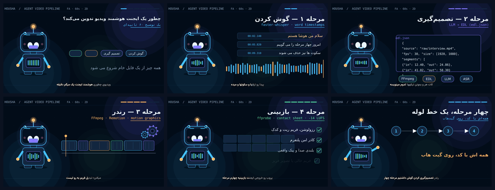

# 🎬 Housha — یک انیمیشن آموزشی ۲بعدی که ایجنت میسازد

[](https://github.com/melimcrr-crypto/agent-2d-explainer/actions/workflows/render.yml) [](LICENSE) [](https://www.python.org/) [](https://github.com/ManimCommunity/manim)

**[▶ تماشای ویدیوی ۶۰ ثانیهای](rendered/explainer-1080p.mp4)** ·
[پیشنمایش GIF](rendered/preview.gif) ·
[کانتکتشیت](rendered/contact-sheet.png) ·
[گزارش QA](rendered/qa.json) ·
[زیرنویس SRT](rendered/explainer.srt)

یک ریپوی کاملاً **کدمحور** که یک انیمیشن **۲بعدی شخصیتمحور** (یک ربات راهنما به اسم «هوشا») را
همراه با **گویندگی فارسی**، **زیرنویس کارائوکهای RTL**، **موسیقی**، **داکینگ صدا**
و **نرمالسازی -۱۴ LUFS** میسازد — و همهٔ اینها را **توی GitHub Actions** رندر میگیرد.
نه نرمافزار تدوین، نه کروم، نه GPU، نه API پولی، نه توکن سرویس خارجی.

<table>
<tr><td align="center"></td>
<td>

**خلاصهٔ فنی**

| بخش | ابزار | مجوز |
| --- | --- | --- |
| موتور انیمیشن ۲بعدی | [Manim Community](https://github.com/ManimCommunity/manim) 0.22 | MIT |
| گویندگی فارسی | [edge-tts](https://github.com/rany2/edge-tts) `fa-IR-DilaraNeural` | GPL-3 |
| زیرنویس RTL | libass + `shaping=complex` + [Vazirmatn](https://github.com/rastikerdar/vazirmatn) | OFL |
| تدوین نهایی | FFmpeg + [ffmpeg-skill](https://github.com/kajisho5/ffmpeg-skill) (QA gate) | MIT |
| موسیقی | `tools/build_music.py` (پروسجرال، نمونهبرداری نشده) | self-made |
| رندر | GitHub Actions (`ubuntu-22.04`, Python 3.11) | — |

</td></tr>
</table>

---

## چرا این ابزارها؟ (خلاصه)

| نیاز | انتخاب | چرا |
| --- | --- | --- |
| **انیمیشن ۲بعدی شخصیت** | **Manim CE** | وکتور واقعی، فریمبهفریم و قطعی، متن فارسی از طریق Pango، بدون مرورگر/کروم، MIT، و راحتترین چیزی که یک LLM میتواند بنویسد. کاراکتر (`src/character.py`) پلک میزند، نفس میکشد، نگاه میکند، لبش با **زمان واقعی کلمات TTS** حرکت میکند و دست تکان میدهد. |
| تدوین حرفهای | **FFmpeg** + **ffmpeg-skill** | کپشن ASS، `sidechaincompress` برای ducking موسیقی زیر صدا، `loudnorm`، فید، گرید، خروجی ۱۰۸۰p/۷۲۰p/۹:۱۶، و `check.py` به عنوان دروازهٔ تحویل. |
| صدا | **edge-tts** | صدای عصبی فارسی، رایگان، بدون کلید، و مهمتر: **WordBoundary** میدهد → زیرنویس کارائوکه و لیپسینک واقعی. |

[مقایسهٔ کامل با Remotion / HyperFrames / Rive / Revideo / Lottie در `docs/TOOL_CHOICE.md`](docs/TOOL_CHOICE.md).

---

## شروع سریع

```bash
git clone https://github.com/melimcrr-crypto/agent-2d-explainer.git
cd agent-2d-explainer
bash scripts/setup_local.sh          # venv + deps + system ffmpeg + font
make preview                         # رندر سریع 480p15، حدود ۱ دقیقه
# یا رندر کامل دقیقاً مثل CI:
make render                          # 1920x1080 / 30fps / 60s
```

خروجیها در `rendered/`:

```
explainer-1080p.mp4      نسخهٔ اصلی (H.264 + AAC, 60.00s, -14 LUFS)
explainer-720p.mp4       نسخهٔ سبک
explainer-vertical.mp4   ریلز 9:16 با بکگراند بلور
preview.gif              پیشنمایش ۶ ثانیهای
contact-sheet.png        ۶ فریم برای بازبینی سریع
caption-check.png        یک فریم برای چک کردن شِیپینگ فارسی
explainer.srt            زیرنویس نرم
qa.json                  گزارش ffprobe + بلندی صدا + ffmpeg-skill
```

### بدون اینترنت هم کار میکند

کلیپهای صوتی (`assets/audio/voice_*.mp3`) و تمام فایلهای زمانبندی
(`captions/*.json`, `fa.ass`, `fa.srt`) **کامیت شدهاند**. پس CI برای TTS
هیچ درخواست شبکهای نمیکند:

```bash
python tools/build_voice.py --offline   # میکس مجدد + بازسازی ASS/SRT/visemes
python tools/render.py --quality h --fps 30
```

فقط وقتی میخواهی متن گویندگی را عوض کنی به اینترنت نیاز داری:

```bash
$EDITOR storyboard.json       # متن، عنوان، مدت صحنهها
make voice                    # edge-tts (رایگان، بدون توکن)
make render
```

---

## ساختار ریپو

```
storyboard.json            ← تک منبع حقیقت: ۶ صحنه، نقلقولها، تایمینگ، پالت رنگ
src/
  config.py                رنگ/فونت/مسیرها + پیدا کردن ffmpeg
  character.py             «هوشا»: کاراکتر ۲بعدی وکتوری + تمام حرکات ثانویه
  props.py                 موجیصدا، edl.json، تایملاین، چکلیست، چرخدندهها…
  main.py                  صحنهٔ Manim + مکانیزم «Beat» برای تایمینگ دقیق
tools/
  build_voice.py           edge-tts → کلیپها + WordBoundary → ASS/SRT/visemes
  build_music.py           موسیقی پروسجرال و قطعی (numpy)
  edit.py                  تدوین نهایی FFmpeg (همهچیز)
  qa.py                    ffprobe + loudness + ffmpeg-skill check.py
  render.py                ارکستراتور تکدستوری = همان چیزی که CI اجرا میکند
captions/                  فایلهای زمانبندی و زیرنویس (کامیت شده)
assets/                    فونت Vazirmatn + کلیپهای صوتی (کامیت شده)
.github/workflows/render.yml
AGENTS.md / SKILL.md       قرارداد کار برای ایجنتها
docs/                      معماری + دلیل انتخاب ابزارها
```

---

## رندر توی گیت هاب

[`.github/workflows/render.yml`](.github/workflows/render.yml) روی `push` به `main`،
`workflow_dispatch` و هر دوشنبه اجرا میشود:

1. نصب Cairo/Pango/FFmpeg و **رجیستر کردن فونت Vazirmatn در fontconfig**
2. `pip install -r requirements.txt`
3. پین کردن FFmpeg استاتیک (چون نسخهٔ Ubuntu همیشه HarfBuzz ندارد → `shaping=complex`)
4. کلون `kajisho5/ffmpeg-skill` برای دروازهٔ تحویل
5. `python tools/render.py --quality h --fps 30`
   → `offline voice` → `music` → `Manim` → `edit` → `qa`
6. آپلود `rendered/` به عنوان Artifact
7. **کامیت کردن MP4 به خود ریپو** (با `[skip ci]`) تا توی صفحهٔ گیت هاب پخش شود

`paths-ignore: rendered/**` + `[skip ci]` جلوی حلقهٔ بینهایت را میگیرد.

---

## نکات فارسی / RTL

- متن داخل Manim توسط **Pango** شِیپ میشود → نیازی به `arabic-reshaper` نیست.
- زیرنویس ASS با `ass=...:shaping=complex` سوزانده میشود. بدون HarfBuzz،
  shaper سادهٔ FriBidi فارسی را بههم میریزد. `shaping_supported()` در
  `tools/edit.py` این را چک میکند و در صورت نیاز graceful fallback میکند.
- فونت [Vazirmatn](https://github.com/rastikerdar/vazirmatn) (OFL) همراه ریپوست.
- نیمفاصلهها (`\u200c`) توی `storyboard.json` رعایت شدهاند.
- `--task translate` ویسپر همیشه به انگلیسی ترجمه میکند؛ این پروژه اصلاً
  ترجمه نمیکند، مستقیم فارسی synthesize میکند.

---

## مجوز

MIT (کد) · فونت Vazirmatn OFL-1.1 · کلیپهای صوتی ساختهٔ edge-tts هستند.
جزئیات در [LICENSE](LICENSE).

> **یادداشت امنیتی:** توکنی که برای ساخت این ریپو استفاده شد `repo + workflow`
> داشت. چون توی چت پیست شده، حتماً بعد از اتمام کار از
> <https://github.com/settings/tokens> **Revoke**اش کن. ریپو هیچ توکنی را
> در فایلها، workflow یا history ذخیره نمیکند — CI فقط از `GITHUB_TOKEN`
> داخلی گیت هاب استفاده میکند.
